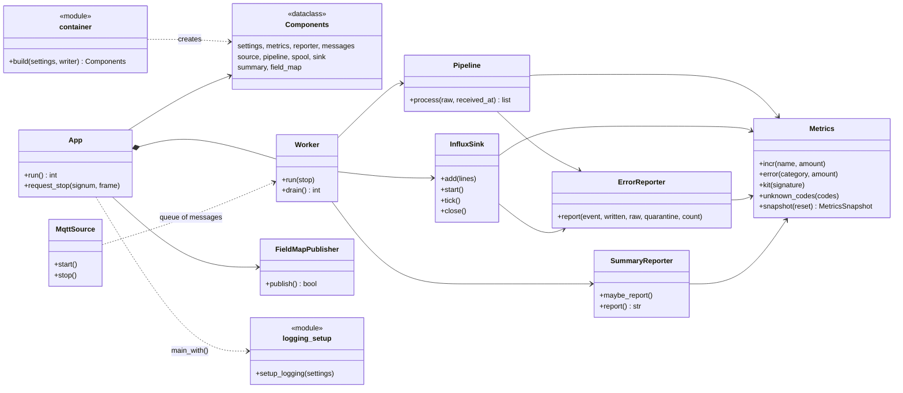
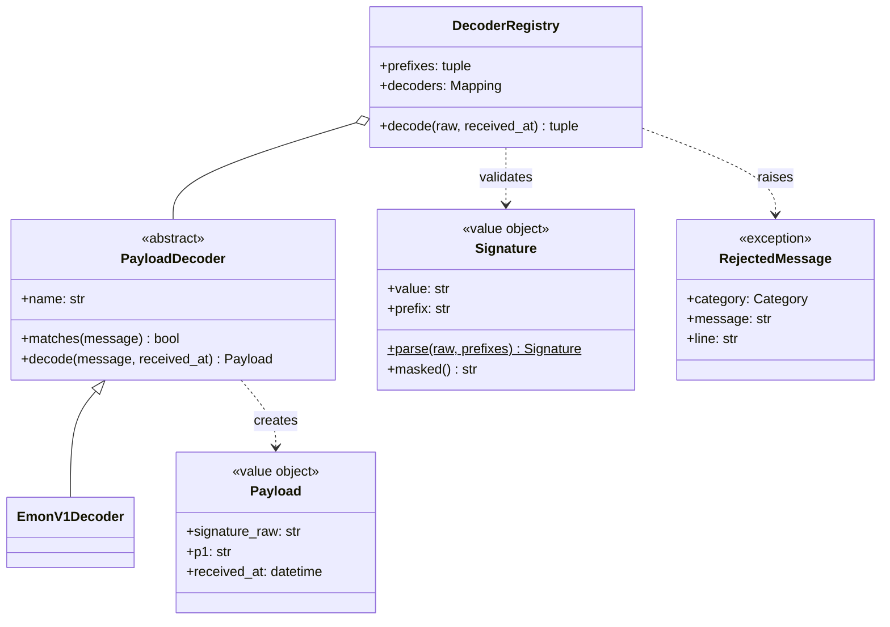
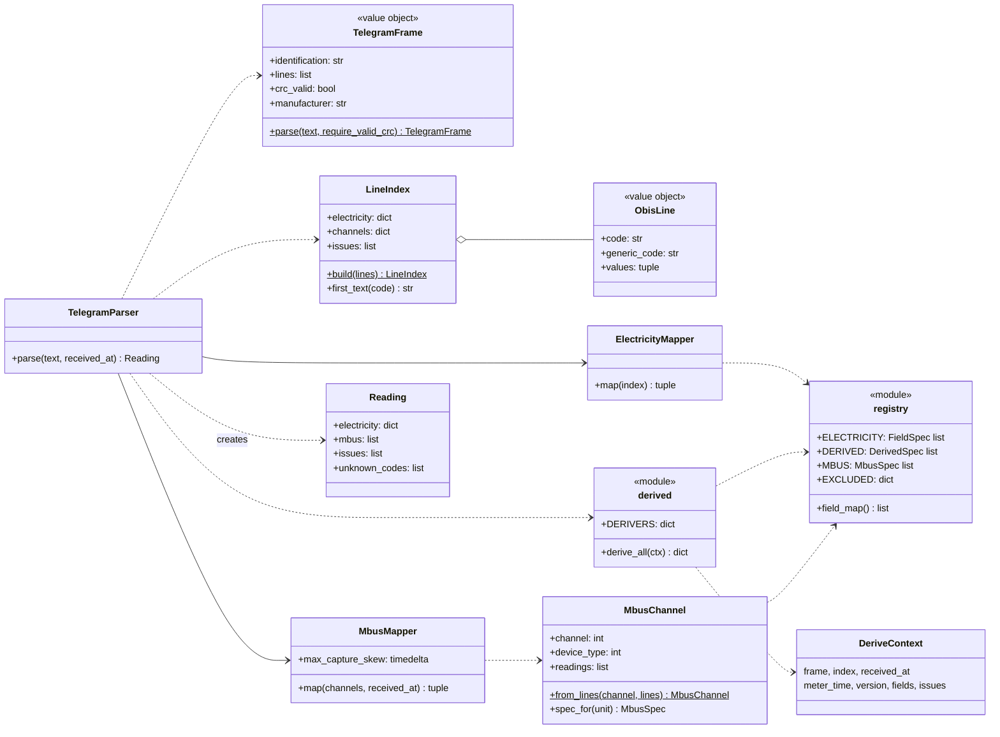
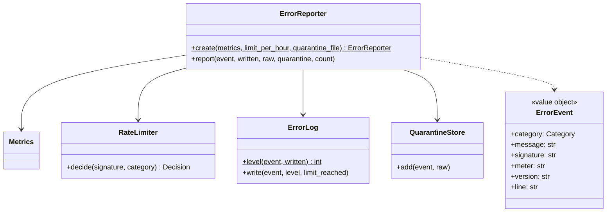
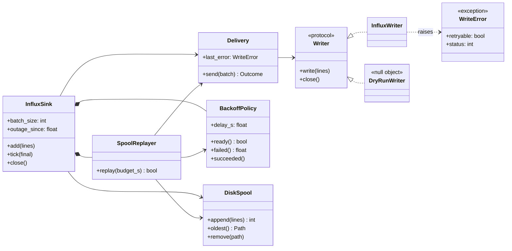
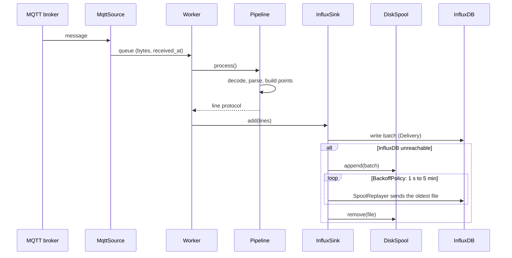

# Class diagram

The classes of `emon2influx`, grouped by responsibility, and how a message flows through them.
See [architecture.md](architecture.md) §6 for the module table and the design patterns.
Diagrams are [Mermaid](https://mermaid.js.org/) and render on GitHub.

## Overview

Every class has one responsibility. `build()` in `container.py` creates and connects them;
`App` only orders start and stop.

## Payload decoding

One decoder per kit generation (strategy); the registry picks it and checks it belongs to the
signature's prefix (architecture §3.3).

## Telegram parsing

`TelegramParser` only coordinates. Fields are found by OBIS code through the registry; a bad
line becomes a `FieldIssue` and the rest of the telegram is kept (architecture §3.4, §4).

## Diagnostics

`ErrorReporter` is a façade: it counts the event, lets the rate limiter decide whether it is
logged, writes it to the error log and, for rejected messages, to the quarantine file.

## Writing and buffering

## Message flow

## Where logs go

| Logger | Content | Destination |
| ------ | ------- | ----------- |
| `emon2influx` | start, stop, outages, hourly summary | console (journald) and `emon2influx-parser.log` |
| `emon2influx.errors` | problems per message | `errors.log` only |
| `QuarantineStore` | rejected messages, identifiers removed | `quarantine.jsonl` |
