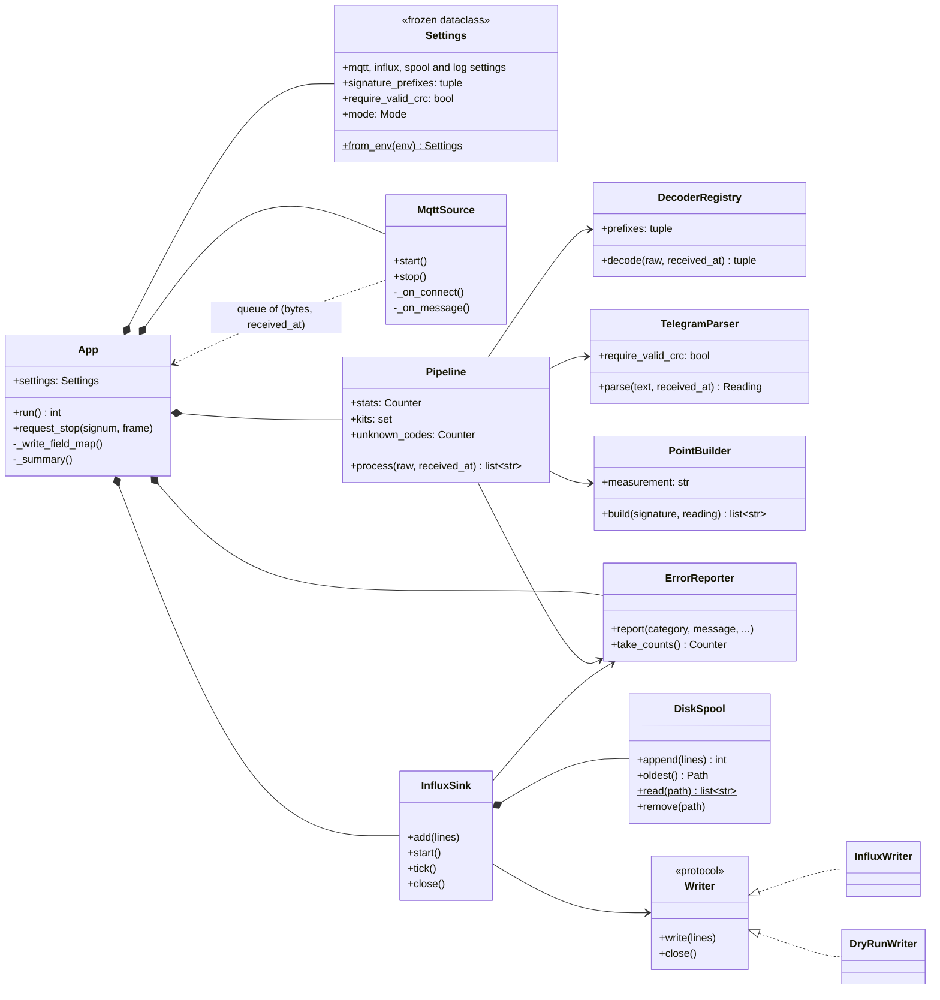
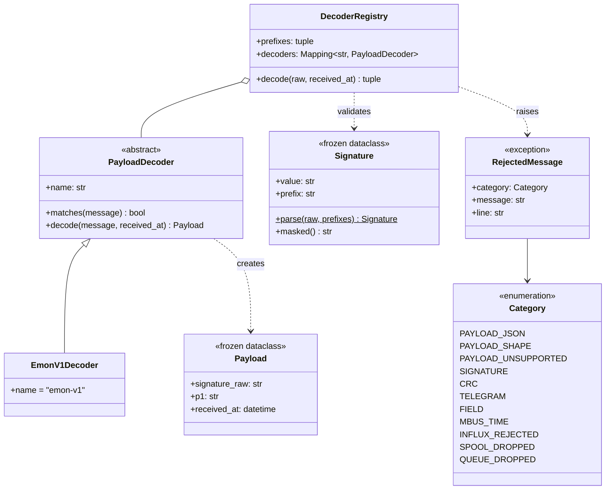
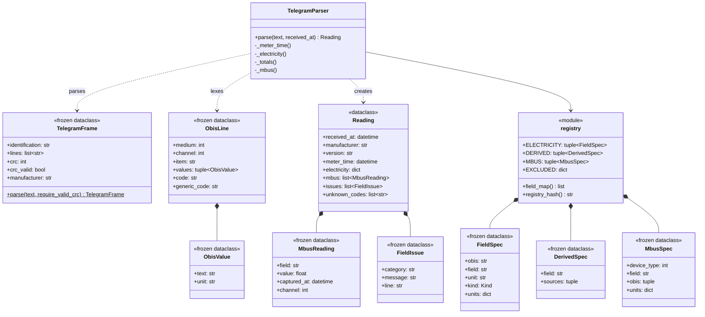
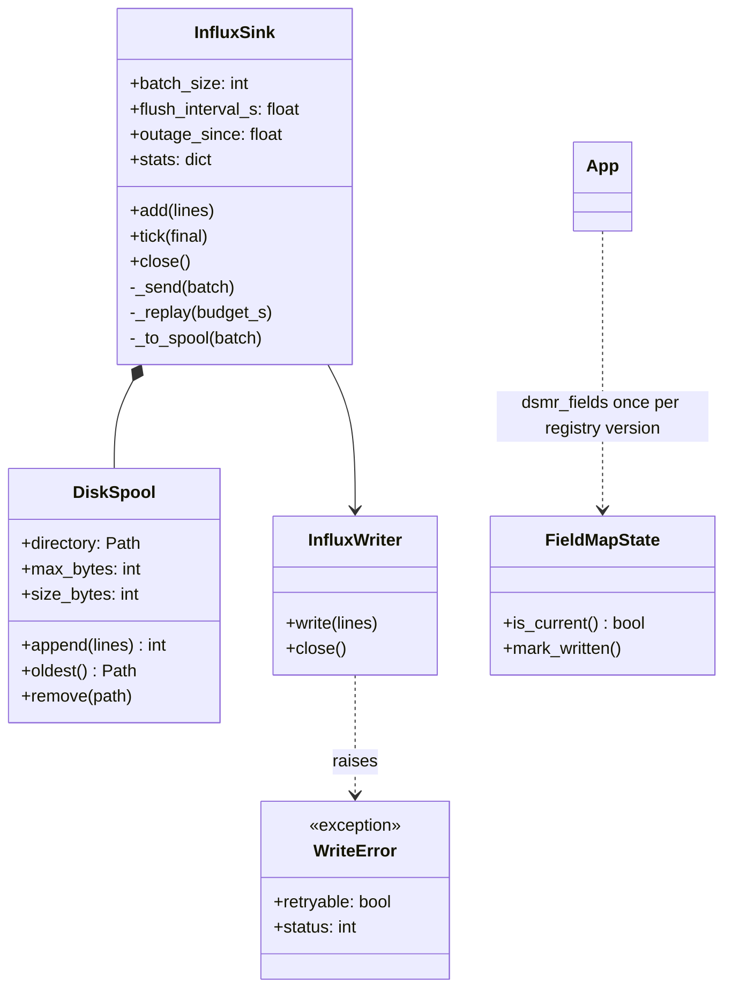
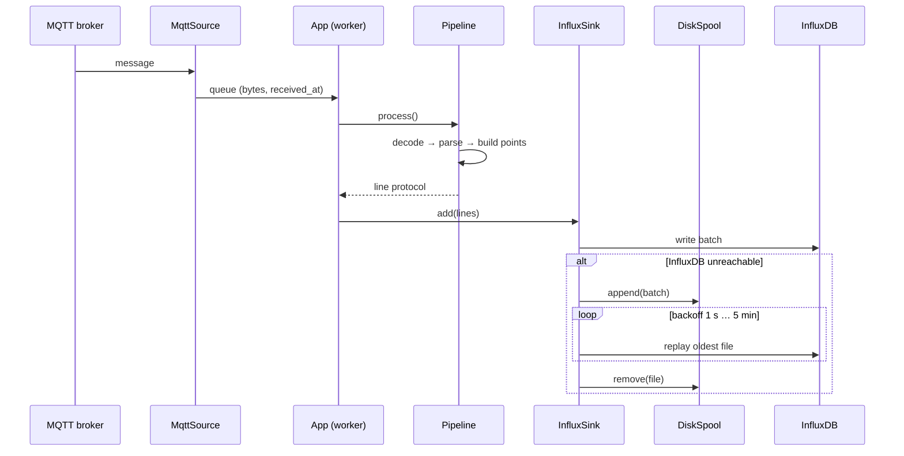

# Class diagram

The main classes of `emon2influx` and how a message flows through them. See
[architecture.md](architecture.md) §6 for the responsibilities. Diagrams are
[Mermaid](https://mermaid.js.org/) and render on GitHub and in most Markdown viewers.

## Overview

## Payload decoding

One decoder per kit generation; the registry picks it and checks that it belongs to the
signature's prefix (architecture §3.3).

## Telegram parsing

Fields are recognised by OBIS code through the registry; one bad line becomes a `FieldIssue`
instead of failing the telegram (architecture §3.4, §4).

## Writing and buffering

## Message flow

## Tools

| Module                         | Purpose                                                       |
| ------------------------------ | ------------------------------------------------------------- |
| `tools.fields`                 | writes `doc/fields.md` and `doc/fields.json` from the registry |
| `tools.replay`                 | replays old logs through the new parser and compares          |
| `tools.compare_buckets`        | compares the reference bucket with the test bucket per kit    |
| `tools.fix_orientation` (next) | one-off correction of swapped counters in history (§13)       |
